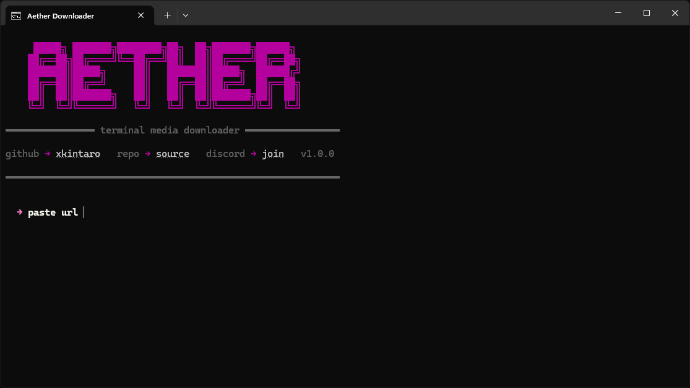

<a href="README.md">
  
</a>
<a href="README-TR.md">
  
</a>

  <br />
  <br />

<div align="center">
  
  <br />
  <br />

  <p>
     Videoları en iyi kalitede MP4 olarak indiren bir terminal aracı.
  </p>


  <p>
    <a href="#about">Hakkında</a> •
    <a href="#features">Özellikler</a> •
    <a href="#tech">Teknolojiler</a> •
    <a href="#setup">Kurulum</a> •
    <a href="#gallery">Galeri</a> •
    <a href="#license">Lisans</a>
  </p>

  <br />
  <br />
</div>

## <a id="about"></a> 📋 Hakkında

**Aether Downloader**, tek bir bağlantıyla video indiren bir terminal uygulamasıdır. YouTube, X, Instagram, TikTok veya yt-dlp'nin desteklediği başka bir siteden bir bağlantı yapıştırın, video mevcut en iyi kalitede MP4 dosyası olarak kaydedilsin.

En iyi görüntü ve ses akışları ayrı ayrı indirilip FFmpeg ile birleştirilir. Böylece 1080p ve 4K gibi yüksek çözünürlükler, daha düşük kaliteli tek dosya biçimleriyle sınırlı kalmaz. FFmpeg ve YouTube'un artık gerektirdiği Deno çalışma ortamı `pip` ile birlikte kurulur, ayrıca bir şey kurmanız gerekmez. İndirme ilerlemesi, dosya boyutu, hız ve kalan süre terminalde anlık olarak gösterilir.

## <a id="features"></a> ✨ Özellikler

- **Geniş site desteği**: YouTube, X, Instagram, TikTok ve yt-dlp'nin desteklediği diğer pek çok siteden video indirin.
- **En iyi kalitede MP4**: En iyi görüntü ve ses tek bir MP4 dosyasında birleştirilir. Dosyanın her yerde oynatılabilmesi için aynı çözünürlükte H.264 tercih edilir.
- **Anlık ilerleme**: Görüntü ve ses indirmelerini boyut, hız ve kalan süre bilgisiyle kendi ilerleme çubuklarında takip edin.
- **Net sonuçlar**: İndirme tamamlandığında video başlığı ve kayıt konumu, başarısız olduğunda ise hata mesajının tamamı gösterilir.
- **Her zaman güncel**: yt-dlp, uygulama her başladığında otomatik olarak güncellenir.
- **Ek kurulum gerekmez**: FFmpeg ve Deno, Python paketi olarak diğer bağımlılıklarla birlikte kurulur.

## <a id="tech"></a> 🛠️ Teknolojiler

`Python` · `yt-dlp` · `Rich` · `questionary` · `Deno` · `FFmpeg`

## <a id="setup"></a> 🚀 Kurulum

### Gereksinimler

- **Python 3.10 veya üstü**

### Adım Adım Kurulum

1. **Depoyu klonlayın**

   ```bash
   git clone https://github.com/xkintaro/aether-downloader.git
   cd aether-downloader
   ```

2. **Bağımlılıkları yükleyin**

   ```bash
   pip install -r requirements.txt
   ```

   Windows'ta bunun yerine `install-requirements.bat` dosyasını çalıştırabilirsiniz. `requirements.txt` her değiştiğinde bu adımı tekrarlayın.

3. **Uygulamayı başlatın**

   ```bash
   python app.py
   ```

   Windows'ta bunun yerine `run.bat` dosyasını çalıştırabilirsiniz.

### Kullanım

- Bir video bağlantısı yapıştırıp Enter tuşuna basın. İndirme hemen başlar.
- Videolar, kullanıcı klasörünüzdeki `Downloads/aether-downloads` klasörüne kaydedilir.
- Uygulamayı kapatmak için `exit`, `q` veya `quit` yazın.

## <a id="gallery"></a> 🖼️ Galeri



## <a id="license"></a> 📄 Lisans

Bu proje MIT Lisansı altında lisanslanmıştır. Detaylar için [LICENSE](LICENSE) dosyasına bakabilirsiniz.

#

<p align="center">
  <sub>❤️ Developed by "Mustafa TAŞAL" (kintaro)</sub>
</p>
