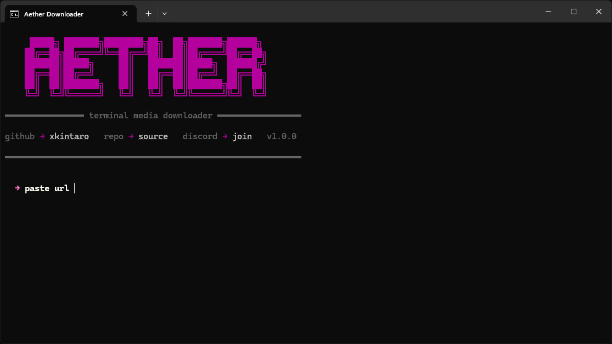

<a href="README.md">
  
</a>
<a href="README-TR.md">
  
</a>

  <br />
  <br />

<div align="center">
  
  <br />
  <br />

  <p>
     A terminal tool that downloads videos in the best quality as MP4.
  </p>


  <p>
    <a href="#about">About</a> •
    <a href="#features">Features</a> •
    <a href="#tech">Tech</a> •
    <a href="#setup">Setup</a> •
    <a href="#gallery">Gallery</a> •
    <a href="#license">License</a>
  </p>

  <br />
  <br />
</div>

## <a id="about"></a> 📋 About

**Aether Downloader** is a terminal application that downloads videos with a single link. Paste a link from YouTube, X, Instagram, TikTok or any other site supported by yt-dlp, and the video is saved in the best available quality as an MP4 file.

The best video and audio streams are downloaded separately and merged with FFmpeg, so high resolutions such as 1080p and 4K are not limited to the lower quality single-file formats. FFmpeg and the Deno runtime that YouTube now requires are installed with `pip`, so there is nothing else to set up. The download progress, file size, speed and remaining time are shown live in the terminal.

## <a id="features"></a> ✨ Features

- **Wide site support**: Download from YouTube, X, Instagram, TikTok and the many other sites supported by yt-dlp.
- **Best quality as MP4**: The best video and audio are merged into a single MP4 file. H.264 is preferred at the same resolution so the file plays everywhere.
- **Live progress**: Follow the video and audio downloads with their own progress bars, including size, speed and remaining time.
- **Clear results**: The video title and the save location are shown when a download completes, and the full message is shown when it fails.
- **Always up to date**: yt-dlp is updated automatically every time the application starts.
- **Nothing extra to install**: FFmpeg and Deno come as Python packages and are set up with the other dependencies.

## <a id="tech"></a> 🛠️ Tech

`Python` · `yt-dlp` · `Rich` · `questionary` · `Deno` · `FFmpeg`

## <a id="setup"></a> 🚀 Setup

### Requirements

- **Python 3.10 or newer**

### Step-by-Step Installation

1. **Clone the repository**

   ```bash
   git clone https://github.com/xkintaro/aether-downloader.git
   cd aether-downloader
   ```

2. **Install dependencies**

   ```bash
   pip install -r requirements.txt
   ```

   On Windows you can run `install-requirements.bat` instead. Run this step again whenever `requirements.txt` changes.

3. **Start the application**

   ```bash
   python app.py
   ```

   On Windows you can run `run.bat` instead.

### Usage

- Paste a video link and press Enter. The download starts right away.
- Videos are saved in the `Downloads/aether-downloads` folder inside your user folder.
- Type `exit`, `q` or `quit` to close the application.

## <a id="gallery"></a> 🖼️ Gallery



## <a id="license"></a> 📄 License

This project is licensed under the MIT License. See the [LICENSE](LICENSE) file for details.

#

<p align="center">
  <sub>❤️ Developed by "Mustafa TAŞAL" (kintaro)</sub>
</p>
